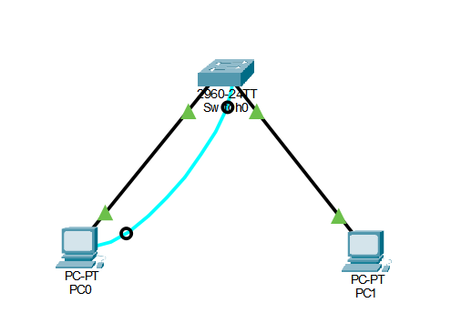

# Cisco-IOS-Basic-Configuration-1
Cisco IOS basic configuration and management lab – CCNA 200-301 practice.
# Cisco IOS – Basic Switch Configuration and Management


## 1. Project Overview

This project is a practical networking lab designed to practice basic Cisco IOS commands using Cisco Packet Tracer.

The main objective is to understand how to configure, manage, monitor, save, restore, and erase a Cisco switch configuration through the Command Line Interface (CLI).

This lab is part of my preparation for the Cisco CCNA 200-301 certification.

## 2. Lab Objectives

During this lab, I practiced the following tasks:

- Navigating between Cisco IOS command modes.
- Configuring a switch hostname.
- Setting up console password authentication.
- Configuring switch interfaces.
- Displaying running and startup configurations.
- Saving and restoring configurations.
- Managing debugging processes.
- Displaying the MAC address table.
- Understanding configuration erasure commands.
- Restarting a Cisco switch.

## 3. Network Topology

The lab uses the following equipment:

| Device | Description |
|---|---|
| SW1 | Cisco Catalyst 2960 Switch |
| PC0 | Computer used for console access and network testing |
| PC1 | Computer connected to the switch |

### Network Diagram



## 4. Commands Practiced

### Basic IOS Navigation

| Command | Description |
|---|---|
| `enable` | Enter privileged EXEC mode |
| `disable` | Return to user EXEC mode |
| `configure terminal` | Enter global configuration mode |
| `exit` | Exit the current configuration mode |
| `end` | Return directly to privileged EXEC mode |
| `Ctrl + Z` | Exit configuration mode |
| `quit` | Explored as a session/navigation command |

### Basic Switch Configuration

| Command | Description |
|---|---|
| `hostname` | Change the switch hostname |
| `line console 0` | Access console line configuration |
| `password` | Set a console password |
| `login` | Enable console password authentication |
| `interface` | Enter interface configuration mode |
| `speed` | Configure interface speed |

### Configuration Management

| Command | Description |
|---|---|
| `show running-config` | Display the active configuration |
| `show startup-config` | Display the saved configuration |
| `copy running-config startup-config` | Save the active configuration |
| `copy startup-config running-config` | Merge the saved configuration into the active configuration |

### Monitoring and Debugging

| Command | Description |
|---|---|
| `show mac address-table` | Display learned MAC addresses |
| `no debug all` | Disable all debugging |
| `undebug all` | Disable all debugging |

### Configuration Erasure and Device Management

| Command | Description |
|---|---|
| `write erase` | Erase the saved configuration |
| `erase startup-config` | Erase the startup configuration |
| `erase nvram:` | Erase NVRAM contents |
| `reload` | Restart the switch |

**Note:** Configuration erasure commands are destructive and should only be tested in a lab environment.

## 5. Practical Configuration

The following configuration was applied to the switch:

```cisco
enable
configure terminal
hostname SWITCH-LAB

line console 0
password Cisco123!
login
exit

interface fastEthernet 0/1
speed 100
exit

end
copy running-config startup-config
```

## 6. Verification

The following commands were used to verify the configuration:

```cisco
show running-config
show startup-config
show mac address-table
```

Screenshots of the configuration and verification steps are available in the `Screenshots` folder.

## 7. What I Learned

Through this practical exercise, I improved my understanding of:

- Cisco IOS command-line navigation.
- The difference between user EXEC, privileged EXEC, and global configuration modes.
- The difference between running-config and startup-config.
- Configuration backup and restoration.
- Basic switch interface configuration.
- MAC address learning and switching.
- Configuration management and device maintenance.

## 8. Lab Environment

- **Software:** Cisco Packet Tracer
- **Device:** Cisco Catalyst 2960
- **Technology:** Cisco IOS
- **Certification Preparation:** CCNA 200-301

---


**Purpose:** Personal learning project – CCNA 200-301 preparation.
